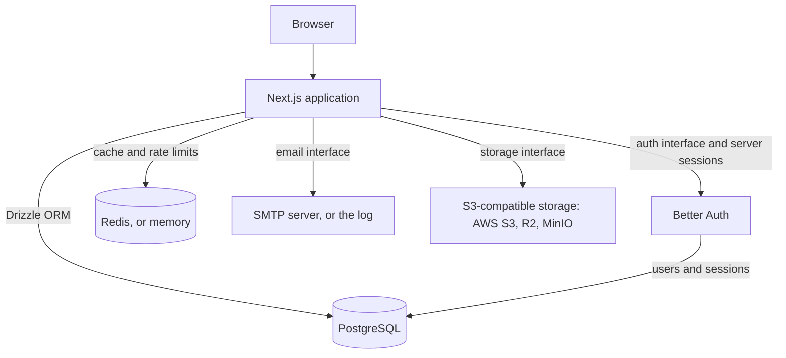

# Upgrade Test

## Generated from

- Starter repository: `Clubedge/clubedge-starter`
- Starter ref: `v0.16.0`
- Starter commit: `e233aa68ddc8c21df6cf2b01b9e26876d2e4aeca`
- Framework: Next.js
- Modules: Authentication: Better Auth, File storage: S3-compatible, Cache and rate limits: Redis, or memory without REDIS_URL, Email: SMTP (any provider, or a local inbox), Payments: None, Background jobs: None, Observability: None, Local infrastructure: No Docker (PGlite and a local folder), Deployment: Railway
- CLI version: `0.24.0`

## Features

**Application**

- Next.js App Router with React, TypeScript, Tailwind CSS 4, and shadcn/ui using Base UI primitives.
- pnpm workspaces and Turborepo, with the web app in `apps/web` and framework-agnostic packages under `packages/`.
- Drizzle ORM and PostgreSQL schema, migrations, and seed commands.
- Zod environment validation, security headers, structured errors, and `/api/health`.
- A landing page and a working dashboard built from the shared UI package.

**Modules**

- Better Auth with users and sessions in your own PostgreSQL, secure session cookies, a protected dashboard, and rate-limited sign-in.
- Password reset by email, and email verification that can be required before sign-in.
- An account settings page: display name, password change, and account deletion.
- Email over SMTP, for any provider or a local inbox; development prints emails to the server log until SMTP is configured.
- S3-compatible storage adapter for AWS S3, Cloudflare R2, and MinIO.
- Fixed-window rate limiter and cache on Redis, falling back to process memory without `REDIS_URL`.

**Production**

- A production image that includes its own migrator (`node /app/migrate.mjs`), for running migrations before each release.
- A manual deploy workflow for the chosen platform, and a readiness endpoint (`/api/ready`) that checks the database.
- Deployment to Railway with `railway.json`: migrations run before each deploy.

**Quality**

- GitHub Actions CI with Vitest, Playwright, ESLint, and Prettier.
- `pnpm check:services`, which proves the app can reach every configured service with a real round trip.

## Quick start

### Requirements

- Node.js 22.12 or newer (Node.js 22 LTS recommended).
- pnpm 10.9.0. The repository pins its package manager version using Corepack.
- PostgreSQL when using database features.

### Install and run

```sh
corepack enable
pnpm install
```

Copy the example environment file to the web app's local environment file.

PowerShell:

```powershell
Copy-Item .env.example apps/web/.env.local
```

macOS/Linux:

```sh
cp .env.example apps/web/.env.local
```

Nothing else to install: `pnpm dev` starts a local PostgreSQL database (PGlite, stored in `.data/`) next to the app and applies the migrations. Files go to a local folder until you configure object storage.

Then start the app. [SETUP.md](SETUP.md) describes every variable and provider.

```sh
pnpm dev
```

Open <http://localhost:3000> for the landing page, <http://localhost:3000/dashboard> for the dashboard, or <http://localhost:3000/api/health> for the liveness endpoint. The pages render without connecting to providers; database and provider operations require their configuration.

> [!NOTE]
> This is a foundation and a reference implementation. Review its security and deployment choices for your application before you go to production; [SETUP.md](SETUP.md#before-deploying) has a checklist.

## How it works



- **PostgreSQL is the source of truth for application data.** Drizzle centralizes application schema, queries, and migrations.
- **Authentication stays separate from application data.** The auth provider owns credentials and sessions; application tables are managed by Drizzle.
- **Providers sit behind interfaces.** Each interface lives in its own package under `packages/`, and each provider in another, so replacing a provider does not touch application code.
- **Shared packages are framework-agnostic.** Packages under `packages/` receive configuration and request cookies as arguments and never import a web framework. ESLint enforces these boundaries.
- **One composition root.** `apps/web/src/server/` is the only place that reads environment variables and chooses providers. Routes and components call it rather than a provider SDK.
- **Keep the baseline focused.** Additional providers and tooling should be added when a real use case calls for them.

## Common commands

Run these from the repository root:

| Command             | Purpose                                        |
| ------------------- | ---------------------------------------------- |
| `pnpm dev`          | Start the web app in development mode.         |
| `pnpm build`        | Create a production build.                     |
| `pnpm start`        | Start the production build.                    |
| `pnpm lint`         | Run ESLint.                                    |
| `pnpm typecheck`    | Typecheck the workspaces.                      |
| `pnpm test`         | Run Vitest.                                    |
| `pnpm test:e2e`     | Run Playwright browser checks.                 |
| `pnpm format`       | Format supported repository files.             |
| `pnpm format:check` | Check formatting without writing files.        |
| `pnpm db:generate`  | Generate Drizzle migrations from the schemas.  |
| `pnpm db:migrate`   | Apply checked-in Drizzle migrations.           |
| `pnpm db:push`      | Push schema directly (local development only). |
| `pnpm db:studio`    | Open Drizzle Studio.                           |
| `pnpm db:check`     | Check migration consistency.                   |
| `pnpm db:seed`      | Seed the configured database.                  |

Playwright's first run may require installing Chromium with `pnpm exec playwright install chromium`. CI runs the browser checks automatically.

Local services:

- `pnpm check:services`: check every configured service with a real round trip.
- `pnpm infra:up`: run only the local database, for example for `pnpm check:services` or browser tests.
- `pnpm infra:reset`: delete the local database and files in `.data/` (stop `pnpm dev` first).

Check the project:

- `pnpm clubedge status`: the project's Starter release, modules, and Git state, whether a newer Starter release exists, and the command to run next.
- `pnpm clubedge doctor`: check Node.js, pnpm, the dependencies, the lockfile, and `apps/web/.env.local` against the example, then run `pnpm check:services`. It changes nothing and exits with an error when a check fails.

Change the project later:

- `pnpm clubedge add <module> <option>`: add a module or switch its option, for example `pnpm clubedge add auth better-auth` or `pnpm clubedge add infra local`. Name several to change them together, as in `pnpm clubedge add email resend payments stripe`. Run `pnpm clubedge add` without arguments to choose from a list.
- `pnpm clubedge remove <module>`: remove one or more modules, for example `pnpm clubedge remove storage`.
- `pnpm clubedge upgrade`: move the project to the newest Starter release. It first lists the releases in between.

These commands merge the change into your code instead of overwriting it: files you never touched are updated, your edits are kept, and lines you both changed get conflict markers, listed per file afterward. Commit first, because they need a clean Git tree so that `git diff` shows the result. Add `--dry-run` to preview a change.

## Documentation

| I want to                                   | Read                                          |
| ------------------------------------------- | --------------------------------------------- |
| Configure the environment and each provider | [SETUP.md](SETUP.md)                          |
| Run the local services                      | [Local services](SETUP.md#local-services)     |
| Deploy the app                              | [Deploy](SETUP.md#deploy)                     |
| Check the app before going live             | [Before deploying](SETUP.md#before-deploying) |
| Fix a common problem                        | [Troubleshooting](SETUP.md#troubleshooting)   |
| Contribute code                             | [CONTRIBUTING.md](CONTRIBUTING.md)            |
| Get help                                    | [SUPPORT.md](SUPPORT.md)                      |
| Report a security problem                   | [SECURITY.md](SECURITY.md)                    |

## Repository structure

- `apps/web/`: the web app, with routes, UI, and the composition root in `src/server/`
- `e2e/`: Playwright browser checks
- `packages/core/`: errors, `Result` type, HTTP helpers, and the error reporting and tracing hooks (no dependencies)
- `packages/db/`: Drizzle schema, client factory, migrations, and seed script
- `packages/auth/`: `AuthProvider` and `CookieStore` interfaces
- `packages/auth-better-auth/`: Better Auth adapter, with its own tables and migrations
- `packages/storage/`: `StorageProvider` interface
- `packages/storage-s3/`: S3-compatible storage adapter
- `packages/cache/`: `Cache` and `RateLimiter` interfaces with in-memory implementations
- `packages/cache-redis/`: Redis rate limiter and cache
- `packages/email/`: `EmailProvider` interface with console and in-memory providers
- `packages/email-smtp/`: SMTP email provider
- `packages/ui/`: shared shadcn/ui components, utilities, and global theme styles
- `.github/`: CI workflow, issue forms, and pull request template
- `SETUP.md`, `CONTRIBUTING.md`, `SECURITY.md`: setup, contribution, and security guides

The project name, description, service identifier, and documentation links live in `apps/web/src/config/site.json`. Edit that file to rename the app; `create-clubedge-app` writes it for generated projects.

## Shared UI components

The shared component package is `@clubedge/ui`. It uses the shadcn `base-nova` style, which generates components backed by `@base-ui/react` rather than Radix UI. The landing page and dashboard demonstrate the shared sidebar, breadcrumbs, theme switch, buttons, cards, badges, separators, inputs, labels, and tables. The light/dark theme preference is stored in the browser; dark mode uses a `#151515` page background and blue `#2563eb` primary color.

Add a component from the repository root using the web app's config:

```sh
pnpm dlx shadcn@latest add badge -c apps/web
```

Shared components are generated under `packages/ui/src/components` and can be imported from `@clubedge/ui/components/<component>`. The app and `packages/ui` `components.json` files intentionally share the `base-nova` style, neutral color base, Lucide icons, Tailwind v4 stylesheet, and RTL-aware generation setting. The app currently renders English in LTR; set the root document's `lang` and `dir` for the locale used by your application. Put app-only components in `apps/web/src/components`.

## Contributing

Please read [CONTRIBUTING.md](CONTRIBUTING.md) before opening an issue or pull request. For local changes, run the relevant checks before submitting. You can report vulnerabilities privately using the process in [SECURITY.md](SECURITY.md).

## License

Copyright © 2026 Clubedge Digital Systems. This project is licensed under the Apache License, Version 2.0. See [LICENSE](LICENSE) and [NOTICE](NOTICE).
